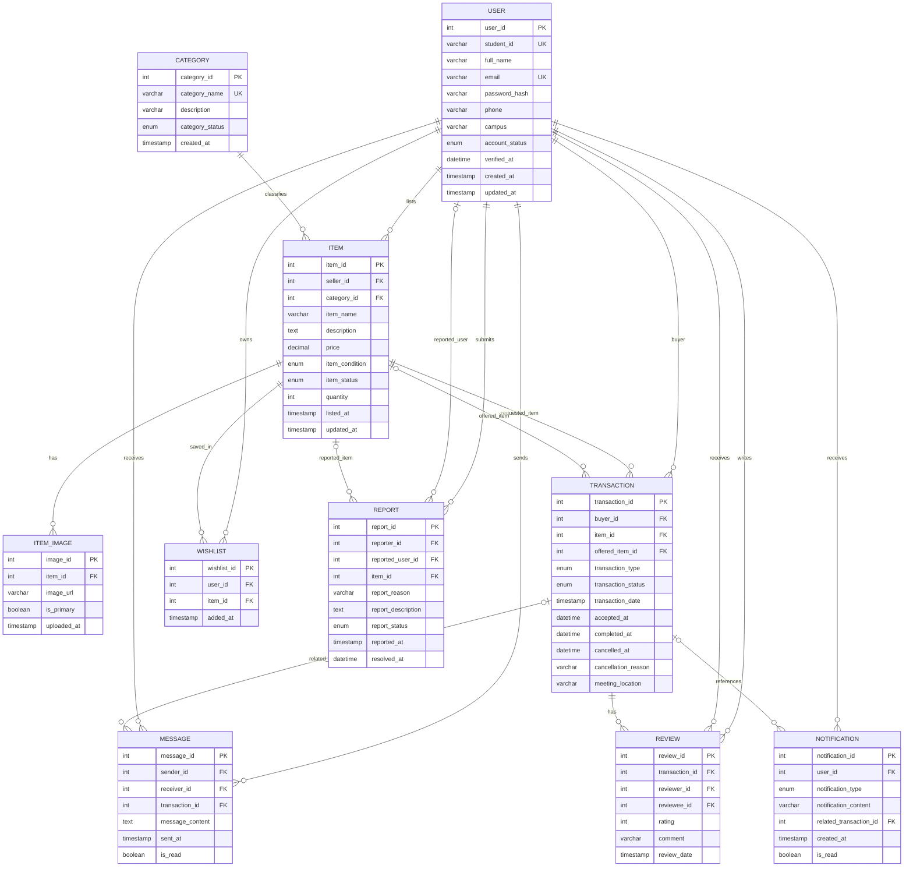

# Campus Bazaar — Updated Entity Relationship Diagram

**System:** Campus Bazaar: Pre-Loved Textbook & Gear Exchange  
**Database target:** MySQL 8.0.16+

## ERD

## Entity purpose

| Entity | Purpose |
|---|---|
| USER | Student accounts, campus details and account verification/status. |
| CATEGORY | Classification of marketplace listings. |
| ITEM | Item listings created by student sellers. |
| ITEM_IMAGE | One or more images attached to an item. |
| TRANSACTION | Purchase or exchange request for a listed item. The seller is obtained through `ITEM.seller_id`, avoiding duplicated seller data. |
| WISHLIST | Items saved by users for later. |
| MESSAGE | Direct messages between students, optionally associated with a transaction. |
| REVIEW | A rating and comment from one transaction participant to the other. |
| NOTIFICATION | Alerts delivered to a user. |
| REPORT | A complaint about a user or an item for moderation. |

## Relationship and cardinality notes

- One USER can list many ITEM records; each ITEM has one seller.
- One CATEGORY can classify many ITEM records; each ITEM belongs to one category.
- One ITEM can have many ITEM_IMAGE records.
- One USER can submit many TRANSACTION records as buyer. The seller is the owner of the requested ITEM.
- A TRANSACTION references one requested ITEM and may reference one offered ITEM for an exchange. An ITEM can be referenced by many transaction records over time, although business rules prevent concurrent accepted requests.
- USER and ITEM have a many-to-many relationship through WISHLIST. A unique constraint prevents the same user saving the same item more than once.
- USER participates in MESSAGE twice: as sender and receiver. A message may optionally reference a transaction.
- USER participates in REVIEW twice: as reviewer and reviewee. A transaction can have reviews from its participants; each reviewer may review a transaction only once.
- One USER can receive many NOTIFICATION records. A notification may optionally reference a transaction.
- One USER can submit many REPORT records. Each report targets exactly one user OR one item.

## Important modelling decisions

1. **No separate ADMIN entity:** administrator access can be implemented with a `user_role` field or a separate role/permission model if the project requires multiple roles. The current schema does not yet implement role-based access control.
2. **No PAYMENT or DELIVERY entity:** the current concept uses campus meetups and does not specify integrated online payments or delivery logistics.
3. **Seller is not duplicated in TRANSACTION:** `seller_id` is obtained from the requested item's `seller_id`. This avoids inconsistent seller/item combinations.
4. **Completion confirmation:** the schema has transaction timestamps but not a separate confirmation entity. For robust two-party confirmation, add a `Transaction_Confirmation` entity or two confirmation fields if required by the lecturer/project scope.
5. **Some rules need backend logic:** cross-table rules (such as ensuring the offered item belongs to the buyer, only completed transactions can be reviewed, and both parties confirm completion) cannot be fully enforced by the listed simple foreign keys and CHECK constraints.

## Constraints

- `student_id` and `email` are unique.
- Item price must be zero or greater; quantity must be at least one.
- `offered_item_id` is NULL for PURCHASE and required for EXCHANGE.
- Wishlist `(user_id, item_id)` pairs are unique.
- Review rating is between 1 and 5; one reviewer can review a transaction once.
- A report must target exactly one user or one item.
- Messages cannot be sent from a user to themselves.
